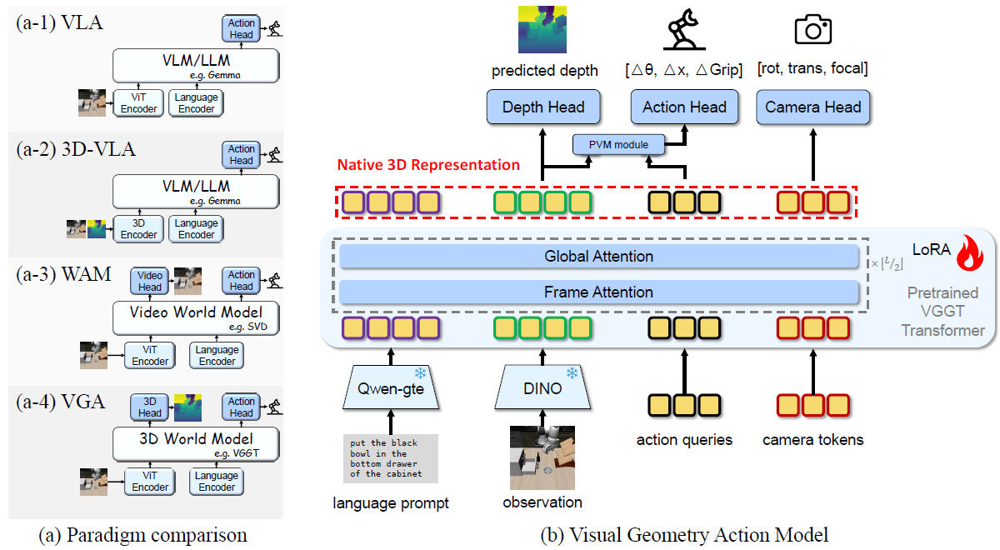

<div align="center">

# VGA: Robotic Manipulation is Vision-to-Geometry Mapping

**Vision-Geometry backbones over language and video models for precise robotic manipulation.**

[](https://www.python.org/)
[](https://pytorch.org/)
[](LICENSE)

**Zijian Song<sup>1</sup>, Qichang Li<sup>1</sup>, Jiawei Zhou<sup>1</sup>, Zhenlong Yuan<sup>4</sup>, Tianshui Chen<sup>3,5</sup>, Liang Lin<sup>1,2,3</sup>, Guangrun Wang<sup>1,2,3</sup>***

<sup>1</sup>Sun Yat-sen University · <sup>2</sup>Guangdong Key Laboratory of Big Data Analysis and Processing · <sup>3</sup>X-Era AI Lab · <sup>4</sup>LongCat, Meituan · <sup>5</sup>Guangdong University of Technology

[Project Page](https://hcplab-sysu.github.io/VisionGeometryActionModel/) · [Paper](https://arxiv.org/abs/2604.12908) · [Code](https://github.com/HCPLab-SYSU/VisionGeometryActionModel)

</div>


---

<p align="center">
  
</p>

<p align="center">
  <em>Fig 1: The illustration of Vision Geometry Action Model.</em>
</p>


---


## Abstract


VGA maps visual observations to geometry before decoding robot actions. This repository provides training and evaluation entry points for LIBERO and LIBERO-plus with a pretrained VGGT backbone.

The public repository's `master` branch contains two modes:

| Mode | Conda environment | Training entry point | Evaluation entry point |
| --- | --- | --- | --- |
| Standard LIBERO | `vga_libero` | `bash run_libero.sh` | `bash eval_libero.sh` |
| LIBERO-plus | `vga_liberoplus` | `bash run_liberoplus.sh` | `bash eval_liberoplus.sh` |


## Contents

- [Model overview](#model-overview)
- [Mode selection](#mode-selection)
- [Installation](#installation)
- [Datasets and assets](#datasets-and-assets)
- [Pretrained models](#pretrained-models)
- [Training](#training)
- [Evaluation](#evaluation)
- [Reproducing the reported results](#reproducing-the-reported-results)
- [Results and baseline comparison](#results-and-baseline-comparison)
- [Troubleshooting](#troubleshooting)
- [Acknowledgements](#acknowledgements)
- [Citation](#citation)

## Model overview

VGA replaces a conventional language or video backbone with a pretrained VGGT 3D world model. Two camera views are processed by VGGT's alternating local and global attention, producing native spatial representations that preserve scene geometry. Learnable action queries and camera tokens connect these representations to the action head; proprioception is projected into the same multimodal sequence.


## Mode selection

Use the matching environment and entry-point pair. No source-code switch is required.

```bash
export PROJECT_ROOT="$(pwd)"
export VGGT_ROOT="$PROJECT_ROOT/../vggt"              # only needed for a source checkout
export VGGT_MODEL_PATH="facebook/VGGT-1B"             # or an existing local VGGT-1B directory

# Standard LIBERO
export LIBERO_ROOT="$PROJECT_ROOT/../LIBERO"
export LIBERO_CONFIG_PATH="$PROJECT_ROOT/data/libero_config"

# LIBERO-plus: use these instead of the two LIBERO variables above
# export LIBEROPLUS_ROOT="$PROJECT_ROOT/../LIBERO-plus"
# export LIBERO_CONFIG_PATH="$PROJECT_ROOT/data/liberoplus_config"
# export PROMPT_ENCODER_PATH="Alibaba-NLP/gte-Qwen2-1.5B-instruct"
```

Model paths may be local directories or Hugging Face IDs.

## Installation

The commands below reproduce the reference environments. `our_envs.txt` is provided as a package snapshot.

### 1. System prerequisites

Use a Linux machine with an NVIDIA GPU, a working CUDA driver, Conda, and Git LFS. The reference environment uses Python 3.10, PyTorch 2.2.0, and CUDA 12.1 wheels.

```bash
conda create -n vga_libero python=3.10 -y
conda activate vga_libero

# Reference build used by the experiments (CUDA 12.1).
pip install torch==2.2.0 torchvision==0.17.0 torchaudio==2.2.0 \
  --index-url https://download.pytorch.org/whl/cu121
# If your driver requires another CUDA build, use the matching command from pytorch.org instead.
pip uninstall -y numpy
pip install numpy==1.26.4
```

### 2. Install VGGT and this repository

Install the official VGGT package and this repository:

```bash
cd "$PROJECT_ROOT/.."
git clone https://github.com/facebookresearch/vggt.git
pip install -e ./vggt

cd "$PROJECT_ROOT"
pip install -e .
pip install packaging ninja
ninja --version
```

Install Flash-Attention 2.5.5:

```bash
pip install "flash-attn==2.5.5" --no-build-isolation
```

If compilation fails, install a matching wheel from the [Flash-Attention releases](https://github.com/Dao-AILab/flash-attention/releases).

### 3. Install ordinary LIBERO (`vga_libero`)

Follow the official [LIBERO installation](https://github.com/Lifelong-Robot-Learning/LIBERO) and keep the checkout outside this repository:

```bash
cd "$PROJECT_ROOT/.."
git clone https://github.com/Lifelong-Robot-Learning/LIBERO.git
export LIBERO_ROOT="$PWD/LIBERO"

pip install -e "$LIBERO_ROOT"

cd "$PROJECT_ROOT"
pip install -r experiments/robot/libero/libero_requirements.txt
```

Download the ordinary LIBERO assets and initial states using the upstream helper:

```bash
cd "$LIBERO_ROOT"
python benchmark_scripts/download_libero_datasets.py --use-huggingface
cd "$PROJECT_ROOT"
```

Use the upstream installation guide as the reference for standalone LIBERO. Keep the project-wide PyTorch version above.

For EGL errors, install:

```bash
sudo apt-get update
sudo apt-get install -y libgl1-mesa-dev libegl1-mesa-dev libgles2-mesa-dev libglew-dev
```

### 4. Create the LIBERO-plus environment (`vga_liberoplus`)

Clone the working LIBERO environment. LIBERO-plus replaces the `libero` package:

```bash
conda create -n vga_liberoplus --clone vga_libero
conda activate vga_liberoplus

cd "$PROJECT_ROOT/.."
git clone https://github.com/sylvestf/LIBERO-plus.git
export LIBEROPLUS_ROOT="$PWD/LIBERO-plus"

cd "$LIBEROPLUS_ROOT"
pip uninstall -y libero
pip install -e .
pip install -r extra_requirements.txt
```

On a clean Ubuntu machine, LIBERO-plus may also require the packages listed in its official guide:

```bash
sudo apt-get install -y libexpat1 libfontconfig1-dev libpython3-stdlib libmagickwand-dev
```

### 5. Keep a separate simulator configuration for each mode

Create one `config.yaml` directory per mode and select it with `LIBERO_CONFIG_PATH`.

```bash
python - <<'PYCONFIG'
import os
from pathlib import Path

project = Path(os.environ["PROJECT_ROOT"]).resolve()
for mode, variable in (("libero", "LIBERO_ROOT"), ("liberoplus", "LIBEROPLUS_ROOT")):
    root = Path(os.environ[variable]).resolve() / "libero/libero"
    directory = project / "data" / f"{mode}_config"
    directory.mkdir(parents=True, exist_ok=True)
    paths = {
        "benchmark_root": root,
        "assets": root / "assets",
        "bddl_files": root / "bddl_files",
        "init_states": root / "init_files",
        "datasets": root.parent / "datasets",
    }
    (directory / "config.yaml").write_text(
        "".join(f"{key}: {str(value)!r}\n" for key, value in paths.items())
    )
PYCONFIG
```

Use `data/libero_config` with `vga_libero` and `data/liberoplus_config` with `vga_liberoplus`. Set the variable before importing `libero` or starting an evaluator.

### 6. Verify the installation

Run these checks in the environment you intend to use:

```bash
python - <<'PY'
import torch
print("torch:", torch.__version__)
print("cuda available:", torch.cuda.is_available())
import prismatic
print("prismatic import: ok")
PY
```

For standard LIBERO, verify `import libero` after activating `vga_libero`. For LIBERO-plus, verify it after activating `vga_liberoplus` and confirm that `LIBEROPLUS_ROOT/libero/libero/benchmark/task_classification.json` exists.

## Datasets and assets

### RLDS training datasets

The training code uses the RLDS conversion published by OpenVLA. Download the four no-noop datasets from [modified_libero_rlds](https://huggingface.co/datasets/openvla/modified_libero_rlds):

```bash
mkdir -p data/libero
git lfs install
# Either clone with Git LFS or download the dataset files from the page above.
git clone https://huggingface.co/datasets/openvla/modified_libero_rlds data/libero
```

`--data_root_dir` must contain the dataset directories directly:

```text
data/libero/
├── libero_spatial_no_noops/1.0.0/
├── libero_object_no_noops/1.0.0/
├── libero_goal_no_noops/1.0.0/
└── libero_10_no_noops/1.0.0/
```

If the download creates an extra `modified_libero_rlds/` directory, move its contents into `data/libero/` or pass its parent directory. `--task_suite` selects the dataset.

### LIBERO-plus assets

LIBERO-plus adds evaluation conditions to the ordinary LIBERO suites. Download its assets from the [LIBERO-plus dataset page](https://huggingface.co/datasets/Sylvest/LIBERO-plus/tree/main) and unpack them under:

```text
$LIBEROPLUS_ROOT/libero/libero/assets/
├── articulated_objects/
├── new_objects/
├── scenes/
├── stable_hope_objects/
├── stable_scanned_objects/
├── textures/
└── ...
```

Training uses the ordinary LIBERO RLDS files; LIBERO-plus changes the evaluation environment and task classification.

## Pretrained models

The following large models are not committed to Git.

1. **Prismatic VLM base model**

   Download [Stanford-ILIAD/prism-qwen25-extra-dinosiglip-224px-0_5b](https://huggingface.co/Stanford-ILIAD/prism-qwen25-extra-dinosiglip-224px-0_5b) into `pretrained_models/prism-qwen25-extra-dinosiglip-224px-0_5b`:

   ```bash
   huggingface-cli download \
     Stanford-ILIAD/prism-qwen25-extra-dinosiglip-224px-0_5b \
     --local-dir pretrained_models/prism-qwen25-extra-dinosiglip-224px-0_5b
   ```

   The checked-in `pretrained_models/configs/` files provide the configuration and processor metadata used by both training scripts.

   The loader also needs the Qwen2.5-0.5B tokenizer/config.

2. **VGGT-1B**

   Set `VGGT_MODEL_PATH` to a local checkout of [facebook/VGGT-1B](https://huggingface.co/facebook/VGGT-1B), or leave it as the Hugging Face ID so that Transformers downloads it on first use:

   ```bash
   export VGGT_MODEL_PATH="facebook/VGGT-1B"
   # Example for a local copy:
   # export VGGT_MODEL_PATH=/models/VGGT-1B
   ```

3. **GTE prompt encoder**

   LIBERO-plus training and evaluation use [Alibaba-NLP/gte-Qwen2-1.5B-instruct](https://huggingface.co/Alibaba-NLP/gte-Qwen2-1.5B-instruct). Set `PROMPT_ENCODER_PATH` to its local directory or its Hugging Face ID:

   ```bash
   export PROMPT_ENCODER_PATH="Alibaba-NLP/gte-Qwen2-1.5B-instruct"
   ```

   The prompt cache is generated at `data/libero_<suite>_prompt_cache.pt`.

## Training

`run_libero.sh` and `run_liberoplus.sh` are complete training templates. The suffix selects the simulator mode. Both use four GPUs by default.

The shared training settings are summarized below; the shell scripts remain the authoritative source for the full command line.

| Mode | GPUs | Batch / GPU | Gradient accumulation | Effective batch | Initial LR | LoRA rank | Save frequency |
| --- | ---: | ---: | ---: | ---: | ---: | ---: | ---: |
| LIBERO | 4 | 16 | 1 | 64 | `2e-4` | 64 | 2k |
| LIBERO-plus | 4 | 16 | 1 | 64 | `2e-4` | 64 | 5k |

Both recipes use two images, proprioception, LoRA fine-tuning, merged checkpoints, and the Pro action head. LIBERO-plus also uses GTE. See the scripts for the complete command lines.

The experiments use NVIDIA A100-SXM4-80GB GPUs. Adjust `CUDA_VISIBLE_DEVICES` for other machines.

### Standard LIBERO

```bash
conda activate vga_libero
export LIBERO_ROOT="$PROJECT_ROOT/../LIBERO"
export LIBERO_CONFIG_PATH="$PROJECT_ROOT/data/libero_config"
export VGGT_MODEL_PATH="facebook/VGGT-1B"
bash run_libero.sh
```

Set `--task_suite` to `spatial`, `object`, `goal`, or `10`. Checkpoints are saved as:

```text
outputs/<suite>/<run>/training_args.json
outputs/<suite>/<run>--<step>_chkpt/
```

For staged training, resume with `--resume True --resum_vla_path <checkpoint> --resume_step <step>`. The run name is recovered from the checkpoint path.

`model_mode=libero` and `model_mode=liberoplus` are saved in `training_args.json` and restored by the evaluator.

#### BOS-token compatibility

LIBERO checkpoints use the historical BOS-offset layout. LIBERO-plus uses the corrected image-first layout. We did not rerun LIBERO with the corrected layout, so the reported LIBERO results and weights remain tied to the historical implementation.

### LIBERO-plus recipe

```bash
conda activate vga_liberoplus
export LIBEROPLUS_ROOT="$PROJECT_ROOT/../LIBERO-plus"
export LIBERO_CONFIG_PATH="$PROJECT_ROOT/data/liberoplus_config"
export VGGT_MODEL_PATH="facebook/VGGT-1B"
export PROMPT_ENCODER_PATH="Alibaba-NLP/gte-Qwen2-1.5B-instruct"
bash run_liberoplus.sh
```

The LIBERO-plus template uses GTE and the same image/proprioception settings as the reported runs:

```text
--use_gte_encoder True
--prompt_encoder_path $PROMPT_ENCODER_PATH
--num_images_in_input 2
--use_proprio True
```

`--use_lora True` trains a LoRA adapter and `--merge_lora_during_training True` also writes a merged model into the checkpoint. Set `--use_lora False --use_fz True` for the full/frozen variant. Each run stores `training_args.json`, including the selected mode (`libero` or `liberoplus`) and any GTE dimensions needed by the evaluator.

For smaller GPUs, reduce `--batch_size` and increase `--grad_accumulation_steps` to preserve the effective batch size.

## Evaluation

Evaluation expects `training_args.json` beside the step checkpoint under `outputs/<suite>/`. Results are written under `experiments/logs/`; videos are written under `rollouts/`.

Both evaluators read the saved mode and GTE settings from `training_args.json`. For a GTE checkpoint, provide `--prompt_encoder_path "$PROMPT_ENCODER_PATH"`.

### Ordinary LIBERO

Use `eval_libero.sh` and edit its checkpoint path and suite when needed:

```bash
conda activate vga_libero
export LIBERO_ROOT="$PROJECT_ROOT/../LIBERO"
export LIBERO_CONFIG_PATH="$PROJECT_ROOT/data/libero_config"
bash eval_libero.sh
```

To run the equivalent command directly:

```bash
$CONDA_PREFIX/bin/python experiments/robot/libero/run_libero_eval.py \
  --pretrained_checkpoint outputs/object/object_lora_011--36000_chkpt \
  --task_suite_name libero_object \
  --use_pro_version True \
  --use_proprio True \
  --num_images_in_input 2 \
  --num_trials_per_task 50
```

### LIBERO-plus

Use `eval_liberoplus.sh` in `vga_liberoplus`. Edit its checkpoint path, suite, and category before launching. Set `LIBEROPLUS_ROOT` so the script can locate `task_classification.json`; the path can also be supplied explicitly with `--task_classification_path`.

```bash
conda activate vga_liberoplus
export LIBEROPLUS_ROOT="$PROJECT_ROOT/../LIBERO-plus"
export LIBERO_CONFIG_PATH="$PROJECT_ROOT/data/liberoplus_config"
export PROMPT_ENCODER_PATH="Alibaba-NLP/gte-Qwen2-1.5B-instruct"
export VGGT_MODEL_PATH="facebook/VGGT-1B"
bash eval_liberoplus.sh
```

To run the equivalent command directly:

```bash
$CONDA_PREFIX/bin/python experiments/robot/libero/run_liberoplus_eval.py \
  --pretrained_checkpoint outputs/goal/goal_lora_320--30000_chkpt \
  --task_suite_name libero_goal \
  --task_category "Camera Viewpoints" \
  --prompt_encoder_path "$PROMPT_ENCODER_PATH" \
  --use_pro_version True \
  --use_proprio True \
  --num_images_in_input 2 \
  --num_trials_per_task 1
```

Supported `--task_category` values are:

```text
Camera Viewpoints
Robot Initial States
Language Instructions
Light Conditions
Background Textures
Sensor Noise
Objects Layout
```

The reported runs use one trial per category. Omit `--task_category` to evaluate the complete suite.

For a new run, replace `--pretrained_checkpoint` and set `--task_suite_name` to the matching suite.

## Reproducing the reported results

The reported runs use four GPUs, batch size 16 per GPU, gradient accumulation 1 (effective batch size 64), LoRA rank 64, and initial learning rate `2e-4`. See the scripts for the complete settings.

### Standard LIBERO schedule

The standard results use the following schedules. A two-stage row means that the second stage resumes from the checkpoint at the end of stage one; `max_steps` is the global step after resuming.

| Suite | Stage 1 | Stage 2 | Final checkpoint | Success rate |
| --- | --- | --- | ---: | ---: |
| Spatial | `2e-4` to 6k | `2e-5` from 6k to 15k | 15k | **99.0%** |
| Object | `2e-4` to 43k | — | 43k | **99.6%** |
| Goal | `2e-4` to 34k | `5e-5` from 34k to 106k | 106k | **98.6%** |
| Long (`10`) | `2e-4` to 69k | `2e-5` from 69k to 126k | 126k | **95.0%** |

For a one-stage run, edit `--task_suite`, `--learning_rate`, and `--max_steps` in `run_libero.sh`. For a two-stage run, add `--resume True`, `--resum_vla_path <stage-1-checkpoint>`, and `--resume_step <stage-1-step>` to the second command, then set its learning rate and final `--max_steps`. For example, the Spatial continuation uses `--resum_vla_path outputs/spatial/<run>--6000_chkpt`, `--resume_step 6000`, `--learning_rate 2e-5`, and `--max_steps 15000`. The same pattern applies to Goal (`34k → 106k`) and Long (`69k → 126k`). The scheduler in the script has a milestone at 200k, so these staged schedules are implemented by starting the continuation with the lower learning rate shown above.

### LIBERO-plus schedule

The suffix (`50k`, `30k`, or `160k`) is the checkpoint step used for each row.

| Suite / checkpoint | CV | RIS | LI | LC | BT | SN | OL | Avg |
| --- | ---: | ---: | ---: | ---: | ---: | ---: | ---: | ---: |
| Spatial · **50k** | 94.4 | 56.9 | 86.9 | 93.5 | 84.5 | 93.2 | 93.8 | **86.2** |
| Object · **30k** | 97.5 | 32.9 | 95.8 | 97.0 | 84.7 | 98.1 | 68.2 | **82.0** |
| Goal · **30k** | 88.0 | 27.9 | 41.0 | 86.4 | 60.5 | 91.8 | 63.1 | **65.5** |
| Long · **160k** | 65.4 | 42.7 | 96.1 | 86.5 | 45.0 | 76.2 | 67.6 | **68.5** |
| Average | 86.3 | 40.1 | 80.0 | 90.9 | 68.7 | 89.8 | 73.2 | **75.6** |

`CV`, `RIS`, `LI`, `LC`, `BT`, `SN`, and `OL` denote Camera Viewpoints, Robot Initial States, Language Instructions, Light Conditions, Background Textures, Sensor Noise, and Objects Layout. To reproduce a row, edit `--task_suite` and `--max_steps` in `run_liberoplus.sh`, then evaluate with the matching category in `eval_liberoplus.sh`. Keep `--learning_rate 2e-4`, batch size 16, four GPUs, and the other options in the checked-in script unless you are intentionally changing the experiment.

## Results and baseline comparison

The tables report success rates. Missing baseline entries are shown as `—`.

### LIBERO


<table>
<thead>
<tr><th>Method</th><th>Spatial</th><th>Object</th><th>Goal</th><th>Long</th><th>Avg</th></tr>
</thead>
<tbody>
<tr><th colspan="6" align="left">Vision-Language-Action baselines</th></tr>
<tr><td>Octo</td><td>78.9</td><td>85.7</td><td>84.6</td><td>51.1</td><td>75.1</td></tr>
<tr><td>OpenVLA</td><td>84.7</td><td>88.4</td><td>79.2</td><td>53.7</td><td>76.5</td></tr>
<tr><td>GR00T-N1</td><td>94.4</td><td>97.6</td><td>93.0</td><td>90.6</td><td>93.9</td></tr>
<tr><td>UniVLA</td><td>96.5</td><td>96.8</td><td>95.6</td><td>92.0</td><td>95.2</td></tr>
<tr><td>π<sub>0</sub></td><td>90.0</td><td>86.0</td><td>95.0</td><td>73.0</td><td>86.0</td></tr>
<tr><td>π<sub>0.5</sub></td><td>98.8</td><td>98.2</td><td>98.0</td><td>92.4</td><td>96.9</td></tr>
<tr><td>GR00T-N1.6</td><td>97.7</td><td>98.5</td><td>97.5</td><td>94.4</td><td>97.0</td></tr>
<tr><td>OpenVLA-OFT</td><td>97.6</td><td>98.4</td><td>97.9</td><td>94.5</td><td>97.1</td></tr>
<tr><td>VLA-Thinker</td><td>98.7</td><td>99.0</td><td>95.2</td><td>96.9</td><td>97.5</td></tr>
<tr><th colspan="6" align="left">3D-VLA baselines</th></tr>
<tr><td>SpatialVLA</td><td>88.2</td><td>89.9</td><td>78.6</td><td>55.5</td><td>78.1</td></tr>
<tr><td>GeoAwareVLA</td><td>95.0</td><td>100.0</td><td>99.0</td><td>93.0</td><td>96.8</td></tr>
<tr><td>GeoVLA</td><td>98.4</td><td>99.0</td><td>96.6</td><td>96.6</td><td>97.7</td></tr>
<tr><th colspan="6" align="left">World-Action-Model baselines</th></tr>
<tr><td>UniMimic</td><td>89.0</td><td>91.0</td><td>85.0</td><td>59.0</td><td>81.0</td></tr>
<tr><td>WorldVLA</td><td>87.6</td><td>96.2</td><td>83.4</td><td>60.0</td><td>81.8</td></tr>
<tr><td>UVA</td><td>—</td><td>—</td><td>—</td><td>93.0</td><td>93.0</td></tr>
<tr><td>mimic-video</td><td>94.2</td><td>96.8</td><td>90.6</td><td>—</td><td>93.9</td></tr>
<tr><td>Motus</td><td>96.8</td><td>99.8</td><td>96.6</td><td>97.6</td><td>97.7</td></tr>
<tr><th colspan="6" align="left">Ours</th></tr>
<tr><td><strong>VGA</strong></td><td><strong>99.0</strong></td><td><strong>99.6</strong></td><td><strong>98.6</strong></td><td><strong>95.0</strong></td><td><strong>98.1</strong></td></tr>
</tbody>
</table>

### LIBERO-plus

| Method / checkpoint | Camera | Robot | Language | Light | Background | Noise | Layout | Avg |
| --- | ---: | ---: | ---: | ---: | ---: | ---: | ---: | ---: |
| OpenVLA | 0.8 | 3.5 | 23.0 | 8.1 | 34.8 | 15.2 | 28.5 | 15.6 |
| OpenVLA-OFT | 56.4 | 31.9 | 79.5 | 88.7 | 93.3 | 75.8 | 74.2 | 69.6 |
| OpenVLA-OFT<sub>w</sub> | 10.4 | 38.7 | 70.5 | 76.8 | 93.6 | 49.9 | 69.9 | 55.8 |
| NORA | 2.2 | 37.0 | 65.1 | 45.7 | 58.6 | 12.8 | 62.1 | 39.0 |
| WorldVLA | 0.1 | 27.9 | 41.6 | 43.7 | 17.1 | 10.9 | 38.0 | 25.0 |
| UniVLA | 1.8 | 46.2 | 69.6 | 69.0 | 81.0 | 21.2 | 31.9 | 43.9 |
| π<sub>0</sub> | 13.8 | 6.0 | 58.8 | 85.0 | 81.4 | 79.0 | 68.9 | 53.6 |
| π<sub>0</sub>-Fast | 65.1 | 21.6 | 61.0 | 73.2 | 73.2 | 74.4 | 68.8 | 61.6 |
| RIPT-VLA | 55.2 | 31.2 | 77.6 | 88.4 | 91.6 | 73.5 | 74.2 | 68.4 |
| OpenVLA-OFT<sub>m</sub> | 55.6 | 21.7 | 81.0 | 92.7 | 91.0 | 78.6 | 68.7 | 67.9 |
| **VGA · Spatial 50k** | **94.4** | **56.9** | **86.9** | **93.5** | **84.5** | **93.2** | **93.8** | **86.2** |
| **VGA · Object 30k** | **97.5** | **32.9** | **95.8** | **97.0** | **84.7** | **98.1** | **68.2** | **82.0** |
| **VGA · Goal 30k** | **88.0** | **27.9** | **41.0** | **86.4** | **60.5** | **91.8** | **63.1** | **65.5** |
| **VGA · Long 160k** | **65.4** | **42.7** | **96.1** | **86.5** | **45.0** | **76.2** | **67.6** | **68.5** |
| **VGA · Average** | **86.3** | **40.1** | **80.0** | **90.9** | **68.7** | **89.8** | **73.2** | **75.6** |

## Troubleshooting

- **EGL or renderer errors:** install the Mesa/EGL packages listed in the LIBERO installation section and run the evaluator on a machine with an NVIDIA driver that supports off-screen rendering.
- **Wrong LIBERO package is imported:** print `import libero; print(libero.__file__)` after activating the environment. `vga_libero` must resolve the ordinary LIBERO checkout; `vga_liberoplus` must resolve `LIBERO-plus`.
- **LIBERO-plus cannot find task categories:** set `LIBEROPLUS_ROOT` or pass `--task_classification_path` and check that `libero/libero/benchmark/task_classification.json` exists.
- **GTE dimension mismatch:** use the same GTE model family during training and evaluation. The evaluator compares the loaded encoder's `hidden_size` with the values saved in `training_args.json`.
- **Flash-Attention build errors:** install a matching prebuilt wheel and verify `python -c "import flash_attn; print(flash_attn.__version__)"`.
- **B200/Pro6000-class GPUs:** the reference CUDA 12.1 wheel may be unsuitable. Use a PyTorch/CUDA build supported by the driver (the server setup used PyTorch 2.7.1 + cu128 and Flash-Attention 2.8.3) and then rerun the import checks.
- **Out-of-memory during training:** first lower per-device `--batch_size`, then compensate with `--grad_accumulation_steps`; keep the effective batch size and number of GPUs in mind when comparing results.

## Acknowledgements

We thank the authors of [VLA-Adapter](https://github.com/OpenHelix-Team/VLA-Adapter) for releasing a useful open-source repository that helped with the surrounding VLA training and evaluation infrastructure.

## Citation

If you find VGA useful, please cite:

```bibtex
@article{song2026robotic,
  title   = {Robotic Manipulation is Vision-to-Geometry Mapping ($ f (v) \rightarrow G $): Vision-Geometry Backbones over Language and Video Models},
  author  = {Song, Zijian and Li, Qichang and Zhou, Jiawei and Yuan, Zhenlong and Chen, Tianshui and Lin, Liang and Wang, Guangrun},
  journal = {arXiv preprint arXiv:2604.12908},
  year    = {2026}
}
```
